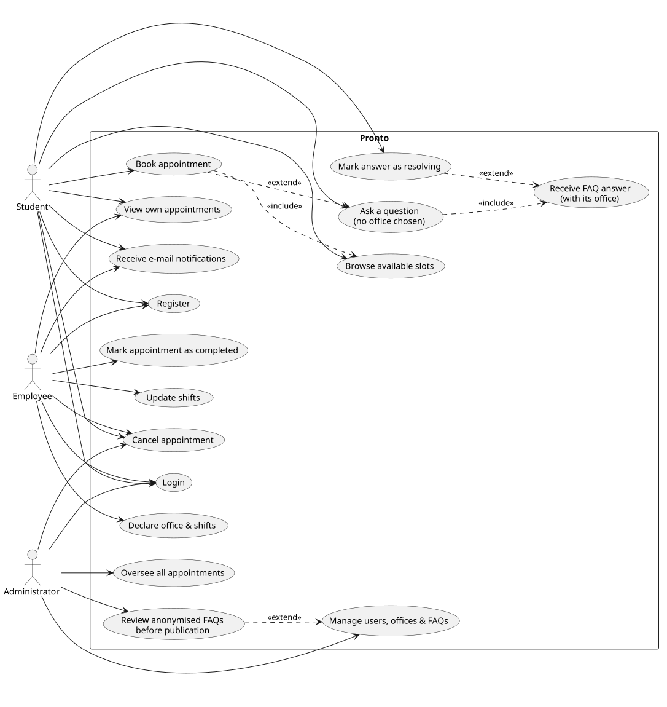

# Requirements

## User stories

1) As a student, I want to register with my personal data and institutional e-mail, so that I can be identified when I book an appointment. 

2) As an employee, I want to register with my institutional e-mail, so that I can work on the appointments of my office. 

3) As an employee, I want to declare and update my weekly shifts, so that students can book slots only when I am available. 

4) As a student, I want to ask a question in free text without choosing an office, so that I can get help even if I do not know which office is responsible. 

5) As a student, I want to receive the correct answer to my inquiry, so that I can solve my problem immediately without booking. 

6) As a student, I want to say whether the suggested answer solves my problem, so that no appointment is created when it does.

7) As a student, I want to book a free slot with the right office when the answer is not enough, so that I can talk to an employee who already knows my question.

8) As a student, I want my booking to be guaranteed once it is confirmed, so that I never find the same employee booked by someone else at the same time.

9) As an employee, I want incoming appointments to be spread evenly among my colleagues, so that nobody in the office is overloaded. 

10) As a student or employee, I want to cancel an appointment before it starts, so that the slot is freed for someone else.

11) As an employee, I want to mark an appointment as completed after the meeting, so that I can keep track of what is still to be done.

12) As a student or employee, I want to be notified by e-mail when an appointment is booked or cancelled.

13) As an administrator, I want to oversee all appointments and maintain users, offices and FAQs.

## Use-case diagram

## Requirements analysis

### Functional requirements

- **FR1** (US1): A student can register, providing name, surname, student ID, course of study and institutional e-mail, and can then authenticate with e-mail and password.

- **FR2** (US2): An employee can register, providing name and surname, and can then authenticate with e-mail and password. The office the employee works for is chosen once, after registration, as the first step of declaring availability (FR4).

- **FR3** (US13): Authenticated users can only access the actions and data pertinent to their role (student or employee). A third role, administrator, is reserved for the staff who run the helpdesk: it cannot be obtained through registration, and administrators oversee all appointments and maintain offices and FAQs.

- **FR4** (US3): An employee can declare their office and weekly shifts; the system computes the bookable time slots of an office on demand, from the shifts declared by its employees, rather than storing them as separate records.

- **FR5** (US3): An employee can update their declared shifts after registration, adding or removing availability.

- **FR6** (US4): A student can ask a question without choosing an office.

- **FR7** (US5, US6): The system suggests the best-matching FAQ answer for the submitted question, if a sufficiently relevant one exists, and the student can mark it as resolving their request.

- **FR8** (US7): If the student is not satisfied by the suggested answer, they can browse the available time slots of the office the answer belongs to, or of an office they pick from the list if no answer was found, and book one, with the original question attached.

- **FR9** (US8): The system prevents two students from being assigned the same employee for the same time slot, even under simultaneous requests.

- **FR10** (US9): The system distributes incoming appointment requests evenly among the employees of the target office who are available in the requested slot.

- **FR11** (US10): A booked appointment can be cancelled, before it starts, by the student who booked it, by the employee assigned to it, or by an administrator.

- **FR12** (US11): An employee can mark a booked appointment as completed once the corresponding meeting has taken place.

- **FR13** (US12): The system notifies the student by e-mail confirming that their appointment has been booked.

- **FR14** (US12): The system notifies the assigned employee by e-mail when a new appointment is booked with them, including the FAQ answer the student was suggested and found unsatisfactory, if any.

- **FR15** (US12): When an appointment is cancelled, the system notifies by e-mail whoever did not cancel it: the employee if the student cancelled, the student if the employee cancelled, and both if an administrator did.

### Non-functional requirements

- **NFR1:** The booking mechanism must guarantee that no employee ever holds two active appointments on the same time slot, even under simultaneous requests.

- **NFR2:** Under normal load, FAQ matching, slot search and appointment booking should each take at most a few seconds.

- **NFR3:** Passwords are never stored in clear text; authenticated requests carry a token issued at login and revoked at logout.

- **NFR4:** The FAQ knowledge base, derived from real historical helpdesk data, is anonymised before being imported, removing any information that could identify the original requester.

- **NFR5:** The development, test and CI environments must be reproducible across machines, so that the observed behaviour does not depend on who runs it or where.

- **NFR6:** Both backend and frontend codebases are covered by automated static analysis (type-checking, linting) and automated tests.

### Implementation requirements

- **IR1**: the backend must be developed in Python, as mandated by the course requirements for the project work.

All other technical choices (Django, PostgreSQL and Chroma for FAQ matching, Vue.js for the frontend, Docker, etc.) are decisions made to satisfy the requirements above, not externally imposed constraints: they are discussed and justified in the [Development](../04-development/) section instead.

## Acceptance criteria

- **AC1** (FR1): given valid, unique registration data, a new student account is created. Registration is rejected if the e-mail does not belong to the `@studio.unibo.it` domain or is already registered.
- **AC2** (FR2): given valid, unique registration data with an e-mail belonging to the `@unibo.it` domain, a new employee account is created; registration is rejected otherwise. 
- **AC3** (FR3): a student cannot access employee-only actions (e.g. declaring availability), and vice versa; a student or employee only sees their own appointments.
- **AC4** (FR4): given a declared shift (e.g. Monday 9:00–12:00) and a fixed slot duration, browsing that office's availability yields a sequence of non-overlapping, contiguous candidate slots covering the whole shift.
- **AC5** (FR5): since time slots are derived from shifts rather than stored, updating a shift immediately changes the availability computed for subsequent browsing.
- **AC6** (FR6): given a free-text question, the question is immediately compared against the FAQs of every office and recorded together with the suggested FAQ, if any, under that FAQ's office.
- **AC7** (FR7): given a question with at least one sufficiently similar FAQ entry, the corresponding answer is shown to the student together with the office it belongs to; no suggestion is shown if no sufficiently relevant match is found.
- **AC8** (FR8): after booking, the appointment is created with an initial "booked" status, the attached question, and exactly one employee of the office assigned to handle it; the slot keeps being offered to other students as long as at least one employee of the office is still free in it, and disappears from the office's availability once all of them are booked. No appointment is created if the student marks the suggested answer as satisfactory.
- **AC9** (FR9): when several booking requests for the same office and time slot are issued at the same time, each either succeeds with a distinct employee assigned, or is rejected; the number of successful bookings never exceeds the number of employees of that office available in that slot.
- **AC10** (FR10): given N employees of the same office sharing the same declared shifts, after a sequence of consecutive bookings on that office the difference between the number of active appointments held by any two of them never exceeds one. Under simultaneous requests the distribution may be briefly unbalanced.
- **AC11** (FR11): given a booked appointment that has not started yet, cancelling it transitions the appointment to the "cancelled" status and frees the corresponding slot.
- **AC12** (FR12): given a booked appointment whose slot has started, the handling employee can mark it completed, transitioning it to the "completed" status.
- **AC13** (FR13): booking an appointment sends exactly one e-mail to the student, with the office, date/time and question, in the language the question was asked in.
- **AC14** (FR14): booking an appointment sends exactly one e-mail, in Italian, to the assigned employee, with the office, date/time, question and suggested FAQ answer, if any.
- **AC15** (FR15): cancelling an appointment sends exactly one e-mail to each recipient listed in FR15.
- **AC16** (NFR1): no employee is ever assigned two active appointments on the same slot.
- **AC17** (NFR2): under normal load, FAQ matching, slot search and booking each answer within a few seconds.
- **AC18** (NFR3): passwords are stored only as hashes; a request without a valid token is rejected, and a token stops working after logout.
- **AC19** (NF1-NF6): if achieved, this will be verified through manual and automated testing.
- **AC20** (I1): the published package and source code declare and require Python >= 3.9, and the software runs correctly under that version.

## Glossary

| Term | Meaning |
|---|---|
| Student | A user who needs information or assistance from a university office and can book appointments. |
| Employee | A staff member of a university office who declares availability and answers booking requests. |
| Administrator | A member of the helpdesk staff who oversees all appointments and maintains users, offices and FAQs. |
| Office | An administrative unit of the Cesena Campus (student administration, international relations, internships) that students can book appointments with. |
| Shift | A stretch of a weekday during which an employee is on duty, repeated every week and declared by the employee. |
| Time slot | A fixed-duration window of time that a student can book with an office, derived from the shifts declared by the office's employees. |
| Assignment | The binding of a booked appointment to the specific employee who will handle it, decided by the system rather than chosen by the student. |
| Appointment | The booking of a time slot by a student, together with the attached question and its lifecycle status (booked, cancelled, or completed). |
| Matricola | The Italian term for a student's university identification number. |
| FAQ | An anonymised question/answer pair from the historical helpdesk dataset. |
| Inquiry | A question asked by a student, recorded with the suggested FAQ and whether it resolved the request. |
| Match | The outcome of comparing a student's question against the FAQ collection, together with a relevance score. |
