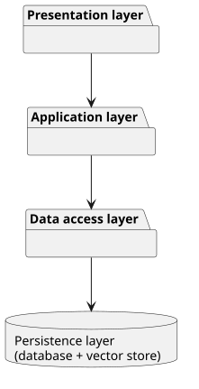
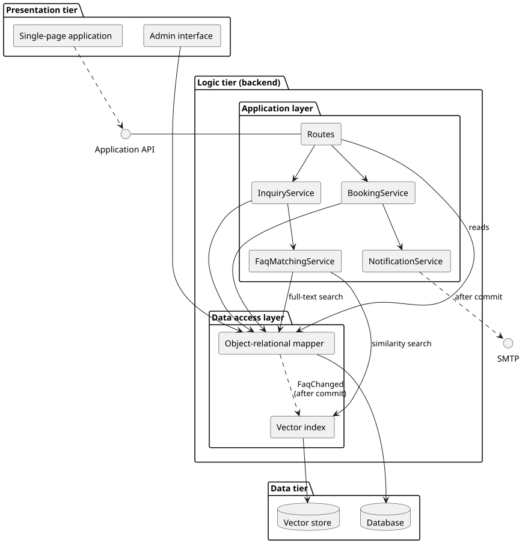
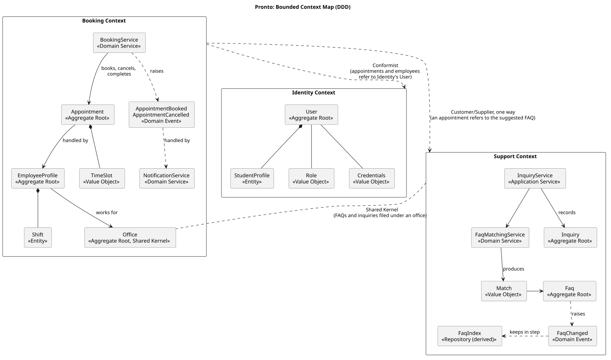
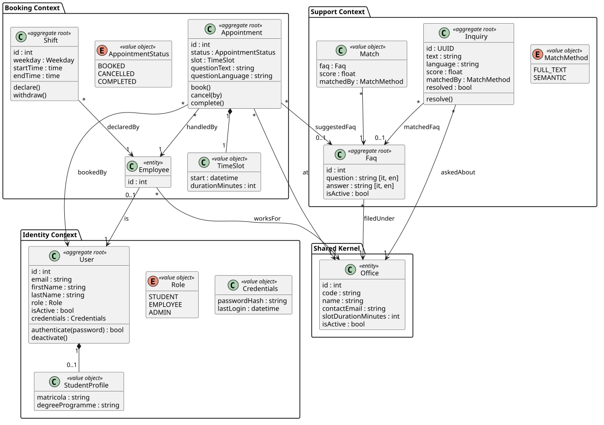
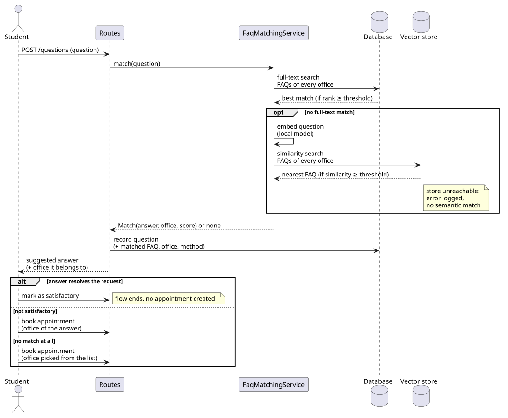
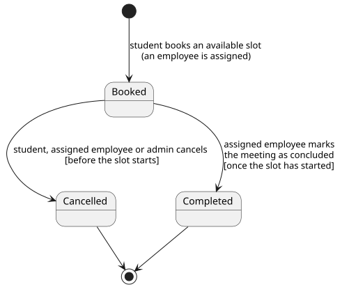

# Design

This chapter describes how Pronto is designed to meet the requirements. It names concepts (a relational database, an object-relational mapper, a vector store) rather than products: the technologies that realise them are chosen and justified in the [Development](../04-development/) section.

## Table of contents

- [Architecture](#architecture)
  - [Architectural style](#architectural-style)
  - [Detailed architecture](#detailed-architecture)
  - [System components](#system-components)
- [Infrastructure](#infrastructure)
  - [Components](#components)
  - [Distribution](#distribution)
  - [Naming and discovery](#naming-and-discovery)
- [Modelling](#modelling)
  - [DDD modelling](#ddd-modelling)
  - [OOP modelling](#oop-modelling)
- [Interactions](#interactions)
- [Behaviour](#behaviour)
- [Data persistence](#data-persistence)

## Architecture

### Architectural style

Pronto has a layered architecture. Each of its four logical layers talks only to the adjacent ones:

- the presentation layer, that renders the user interface;
- the application layer, that holds all the business logic;
- the data access layer, that translates between domain objects and storage operations;
- the persistence layer, that stores the data.

We chose this style because every interaction in Pronto is a synchronous request and response.

We considered three alternatives and discarded them:

- an event-based style assumes asynchronous communication through publish/subscribe, with producers unaware of their consumers, and Pronto's interactions are synchronous;
- an object-based style assumes remote invocation of methods on distributed objects, while Pronto's components exchange explicit requests and responses;
- a shared dataspace would need several components reading and writing the same store, and in Pronto only the backend reaches the database and the vector store.

### Detailed architecture

Pronto is a 3-tier system:

- the presentation tier is implemented by two clients: a single-page application running in the browser, used by students and employees, and an administration interface served by the backend, used by the staff who run the helpdesk;
- the logic tier is implemented by the backend: it exposes the API the single-page application calls, holds the booking, FAQ, authentication and notification logic, and runs the ORM and the vector index in its own process;
- the data tier is implemented by the relational database and the vector store.

The layers map onto the tiers directly. The presentation layer maps onto the presentation tier, the application and data access layers maps onto the logic tier, and the persistence layer maps onto the data tier.

### System components

The single-page application renders the interface and collects input. It turns user actions into API requests and shows the responses: FAQ suggestions, free slots, bookings and the user's own account. It keeps the authentication token and the booking in progress. The administration interface lets the helpdesk staff review and publish FAQs, maintain offices, users and employees' offices, and oversee appointments and the questions students asked. It works on the data access layer directly, without going through the API.

The backend is divided into software components: modules of code, each with one responsibility, that handle the domain entities described in [DDD modelling](#ddd-modelling). A request enters through the Routes, which pass it to a service; the services apply the business rules and read and write the entities through the data access layer.

- Routes expose the API endpoints. They authenticate the caller, check that the caller's role allows the action, validate the request and hand it to a service. Plain reads, such as the list of offices or of the caller's appointments, go straight to the data access layer, scoped to what the caller may see.
- BookingService computes availability, assigns each booking to an employee, checks shifts as they are declared and withdrawn, and moves appointments through their lifecycle.
- InquiryService records each question with the FAQ found for it, and marks it resolved when the student accepts the answer.
- FaqMatchingService finds the published FAQ that best answers a question, first with full-text search in the database and then, if needed, with similarity search over the vector index.
- NotificationService is called by BookingService when an appointment is booked or cancelled, and hands the e-mails to an SMTP server once the change is committed.
- The data access layer has two parts. The ORM maps domain objects to relational tables and gives each aggregate its collection interface, which is where the repositories of the domain model live. The vector index computes embeddings with a model that runs inside the backend, and reads and writes them in the vector store. It is updated whenever a FAQ changes, after the change is committed.

The database stores all application state: users and student profiles, offices, employees and their shifts, appointments, FAQs and the questions students ask. The vector store keeps one embedding per published FAQ and language. 

## Infrastructure

### Components

- Clients (N instances): each student or employee uses Pronto from a web browser running the single-page application, and the helpdesk staff open the administration interface in a browser too. There are as many clients as connected users.
- Web server for the client application (1 instance): it serves the single-page application's code to browsers. The application then calls the backend, which runs on a different origin and accepts cross-origin requests from this one only.
- Application server (1 instance): it runs the backend, which serves the API and the administration interface. The embedding model for semantic matching runs inside this process, so there is no external embedding service.
- Database server (1 instance): it persists all application data.
- Vector store server (1 instance): it stores the FAQ embeddings and answers similarity searches. It is optional: when it is not configured or cannot be reached, FAQ matching uses full-text search alone.
- SMTP server: an external mail server delivers booking and cancellation notices. In development the backend prints the e-mails to its console instead.

### Distribution

Clients run wherever the users are. The web server, the backend, the database and the vector store run as containers on one host and share a private network. Only the backend connects to the database and the vector store. The repositories configure this single-host deployment with every port published on the host's loopback interface only, so nothing is reachable from outside the machine. A public deployment keeps the same layout and puts the web server and the backend behind a public hostname reached over HTTPS.

The SMTP server is a third-party service that the backend reaches through outbound connections, and we do not control where it runs. The embedding model is downloaded from a public model repository the first time it is needed and cached on the application server afterwards.

### Naming and discovery

The single-page application finds the backend through a base URL fixed in its configuration when it is built. In the single-host deployment both the application and the backend are reached at `localhost`; a public deployment would give them a hostname resolved through public DNS, and the base URL would point to it. Inside the private network, the backend finds the database and the vector store by the logical service names the container runtime resolves. The SMTP server and the hosted development database are found through public DNS, like any external service.

## Modelling

### DDD modelling

#### Bounded contexts

Pronto's domain splits into three bounded contexts:

- the Identity context holds the people who use Pronto: their accounts, roles, credentials and the personal data each role requires;
- the Booking context covers reserving appointments with university offices: the employees staffing them, their shifts, the availability derived from those shifts, and the lifecycle of an appointment;
- the Support context is the knowledge base that answers students' questions before any booking: the FAQs, the questions students ask, and the matching between the two.

#### Identity context concepts

- User is the aggregate root. It is a person using Pronto, identified by an institutional e-mail address, with a name, a Role, Credentials and an active flag. 
- Role is a value object: student, employee or administrator. Students and employees get it from the domain of their e-mail address at registration; administrators are created by the staff.
- Credentials is a value object holding the password hash and the time of the last login.
- StudentProfile is an entity inside the User aggregate, holding the student ID and degree programme. 
- UserFactory creates a User at registration. In the implementation, the factory's role is played by the user manager together with the registration serializer.

#### Booking context concepts

- EmployeeProfile is an aggregate root: a user in the employee role and the office they work for. 
- Shift is an entity inside the EmployeeProfile aggregate: a stretch of a weekday the employee is on duty every week. Availability is computed from the shifts and never stored. 
- Appointment is the second aggregate root. It binds the student's User, the handling EmployeeProfile, the Office and the TimeSlot it occupies, and carries the question, its language and, if there was one, the FAQ the student was shown and did not find helpful. 
- TimeSlot is a value object
- AppointmentStatus is a value object: booked, cancelled or completed.
- BookingService is a domain service spanning EmployeeProfile, Office and Appointment. It computes availability, assigns each booking to the least loaded free employee, declares and withdraws shifts, and drives the lifecycle of appointments.
- AppointmentBooked and AppointmentCancelled are domain events raised by BookingService. NotificationService, a domain service, handles them by sending the e-mails once the change is committed.

#### Support context concepts

- Faq is an aggregate root: a question and an answer, each in Italian and English, filed under an office.
- Inquiry is the second aggregate root. It records a question a student asked, the FAQ it was matched to (if any), how relevant that FAQ was, which technique found it, and whether it answered the question.
- Match is a value object: a suggested FAQ with its score and the MatchMethod (full-text or semantic) that found it, which says what the score measures.
- FaqRepository and InquiryRepository are the collections of the two aggregates.
- FaqIndex is a derived repository: the embeddings of the published FAQs, one per FAQ and language, stored in the vector store and searched by similarity. 
- FaqMatchingService is a domain service that compares a question with the published FAQs and returns a Match, or nothing.
- InquiryService is an application service on top of FaqMatchingService.
- FaqChanged is a domain event raised whenever a FAQ is saved or deleted. The FaqIndex handles it after the commit, so it stays in step with the published FAQs.

The contexts relate through different patterns. Booking and Support are bound by a Shared Kernel. Booking is downstream of Identity and conforms to its model: an appointment refers to the student's User and an EmployeeProfile refers to the employee's User, as Identity defines them, with no translation. Booking is also downstream of Support, in one direction only: an appointment refers to the FAQ the student was shown, while nothing in Support knows about appointments. Support does not depend on Identity at all, since an inquiry records no user.

### OOP modelling

The table lists the main types the DDD model turns into.

| Type | Description | Kind / role | Key attributes | Key methods |
|---|---|---|---|---|
| User | A person using Pronto, identified by their institutional e-mail | Entity| email, firstName, lastName, role, isActive, credentials | setPassword(password), checkPassword(password) |
| Role | What a user may do, derived from the e-mail domain at registration | Value Object | STUDENT, EMPLOYEE, ADMIN | none |
| Credentials | How a user proves who they are | Value Object | passwordHash, lastLogin | none |
| StudentProfile | The data only a student has | Entity | matricola, degreeProgramme | clean(): refuses a profile for a user who is not a student |
| UserFactory | Builds a valid User aggregate at registration | Factory | none | register(email, password, firstName, lastName, studentData?): User |
| Office | A helpdesk office students ask about and book with | Entity| code, name [it, en], contactEmail, slotDurationMinutes, isActive | none |
| Language | The language of a question, a FAQ text or a student's e-mails | Value Object| IT, EN | none |
| EmployeeProfile | A user in the employee role, staffing one office | Entity| user, office, shifts | none: changed through BookingService |
| Shift | A stretch of a weekday the employee is on duty every week | Entity| weekday, startTime, endTime | none |
| Appointment | A booked meeting between a student and an employee | Entity| student, employee, office, slot, status, questionText, questionLanguage, suggestedFaq | none: changed through BookingService |
| TimeSlot | The moment an appointment occupies; its length is the office's slot duration | Value object | start | none |
| AppointmentStatus | The lifecycle states of an appointment | Value Object | BOOKED, CANCELLED, COMPLETED | none |
| Faq | A question and its answer, in Italian and English | Entity| office, question [it, en], answer [it, en], isActive | none |
| Inquiry | A question a student asked and the FAQ suggested for it | Entity| id (UUID), office, text, language, matchedFaq, score, matchedBy, resolved | none: resolved through InquiryService |
| Match | A FAQ suggested for a question, with its relevance | Value object | faq, score, matchedBy | officeCode(): the office the answer belongs to |
| BookingService | The booking rules | Domain service | none | availableSlots(office, day), book(...), cancel(appointment, by), complete(appointment), declareShift(...), withdrawShift(shift) |
| FaqMatchingService | Finds the FAQ that best answers a question | Domain service | none | findBestMatch(question, office, language) |none | bestMatch(question, language, candidates) |
| NotificationService | Sends the e-mails of an appointment's lifecycle after the commit | Domain service | none | appointmentBooked(appointment), appointmentCancelled(appointment, by) |
| FaqIndex | The embeddings of the published FAQs, one per FAQ and language | Repository (derived data) | none | syncFaq(faqId), rebuild(), nearest(question, language, faqIds) |

The class diagram shows how the data types relate.

## Interactions

Every interaction in Pronto is a synchronous request and response. The client calls the backend's API, and the backend reaches the database, the vector store and the SMTP server within each request. E-mails are the one exception in timing: they leave only after the request's transaction commits.

The first sequence diagram shows the main flow. The student submits a question without choosing an office, since they often do not know which one is responsible. InquiryService passes it to FaqMatchingService, which searches the published FAQs of every office: full-text search in the database first and, only if that finds nothing above its threshold, a similarity search in the vector store with an embedding of the question computed locally. The first technique to find a match wins. If the vector store cannot be reached, the error is logged and the full-text result stands alone. The question is recorded as an Inquiry with the suggested FAQ, under that FAQ's office, and the student sees the answer and the office it belongs to.

Only the student decides whether to stop there; the system never resolves a request on their behalf. If the student marks the answer as satisfactory, the flow ends and no appointment is created. If not, the client asks for the free slots of the answer's office, or of an office the student picks from the list when nothing matched, and the student books one. BookingService turns it into an appointment carrying the original question and the FAQ the student was shown.

## Behaviour

Most components are stateless. The backend keeps no per-user session in memory, because tokens live in the database. FaqMatchingService computes each match from scratch, and the client keeps only the token and transient interface state. All persistent state is in the database, and only the backend writes to it, through the API or the administration interface, always within a single request. The vector store has no state of its own: its content is derived from the published FAQs and changes only after a FAQ change is committed.

Appointment's state goes through several transitions. It is created BOOKED, already assigned to an employee, and becomes CANCELLED when the student, the assigned employee or an administrator calls it off before the slot starts, or COMPLETED when the assigned employee marks the meeting as concluded.

Two concepts have a two-state life. A User is created active and becomes inactive only if an administrator deactivates the account, which blocks its logins and keeps its appointments. An Inquiry is created unresolved and becomes resolved when the student marks the suggested answer as satisfactory, which requires that an answer was suggested.

## Data persistence

Pronto stores users with their student profiles, offices, employees with their shifts, appointments, FAQs and the questions students ask, because all of them must outlive a request: an appointment booked today is handled next week. This data is structured and full of references, since an appointment points to a student, an employee, an office and a FAQ, and the booking rules rely on unique constraints and transactions. So it lives in a relational database, PostgreSQL, whose full-text search also serves FAQ matching. The embeddings of the published FAQs are vectors that live in a vector store . Only the backend, administration interface included, queries the two stores: it reads shifts, appointments and FAQs, writes appointments and inquiries, and updates the vector store after a FAQ change commits. 
Reads and writes run concurrently. Two students may book the same employee for the same slot at once, so a lock on the employee and a partial unique index on booked slots let only one booking through. 
Components share data only through the database, and the vector store copies the FAQs from it.

