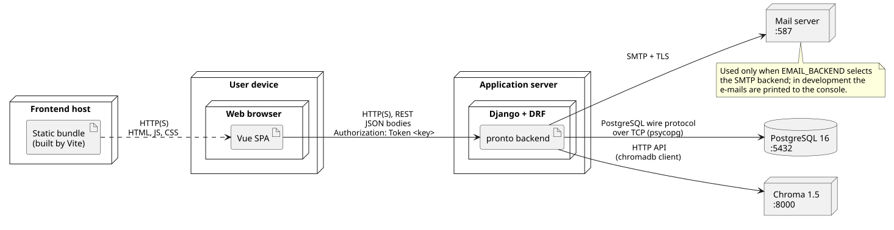

# Development

## DVCS

Pronto lives in three Git repositories hosted under the `unibo-dtm-se-2526-PRONTO` GitHub organisation: the backend, the frontend and this report. All three follow the same conventions.

**Branches.** We adopted a Git Flow model:

- `master` holds released code only, and every merge into it produces a release;
- `develop` is the integration branch, where finished work is collected and kept working;
- work branches start from `develop` and are named after the kind of change: `feature/` for new functionality, `fix/` for bugs, `refactor/`, `test/` and `chore/` for the other kinds of work;
- `hotfix/` branches carry small, urgent corrections.

Each branch covers a single topic, so the branch list mirrors the features of the system.

**Commit messages.** Every commit follows [Conventional Commits]: `type(scope): description`, where the type is one of `feat`, `fix`, `refactor`, `test`, `docs`, `chore`, `ci`, `build` and `style`, and the scope names the Django app or the frontend module involved (e.g. `fix(booking): lock the appointment when cancelling it`).
We enforce the convention with commitlint, which a GitHub Actions workflow runs on every pull request. semantic-release reads the commit types to choose the next version number and to write the changelog.

**Pull requests and code reviews.** No one pushes directly to `develop` or to `master`: every change reaches them through a pull request. A pull request is merged only when the CI checks pass (static checks, formatting, test suite, commit messages) and the other team member has reviewed it. Releases follow the same path: a pull request from `develop` to `master`, which commitlint skips because it only carries commits already checked.

## Implementation details

**Backend structure.** The backend is a Django project split into four apps: `accounts`, `offices`, `booking` and `faq`. The components of the [Design](../03-design/#system-components) map onto the code as follows. The services are modules of functions rather than classes; only the matchers are classes, sharing the `Matcher` interface.

| Design component | Code | Role |
|---|---|---|
| Routes | `*/urls.py`, `*/views.py`, `*/serializers.py`, `pronto/permissions.py` | DRF views and serializers: authentication, role checks, validation, call to a service |
| BookingService | `booking/services.py` | availability, booking with employee assignment, cancellation, completion, shifts |
| InquiryService | `faq/services.py` | records a question with its match, resolves it |
| FaqMatchingService | `faq/matching.py` | `find_best_match` and the `FullTextMatcher`, `SemanticMatcher` and `CascadeMatcher` classes |
| NotificationService | `booking/notifications.py` | renders the e-mails and sends them after the commit |
| ORM and repositories | `*/models.py` | Django models; each model's manager is the repository of its aggregate |
| Vector index | `faq/vector_index.py`, `faq/signals.py` | embeddings in Chroma, kept in step with the FAQs by signals after each commit |
| Admin interface | `*/admin.py` | Django admin pages for the helpdesk staff |

**Network protocols.** Clients talk to the backend over **HTTP** (HTTPS in production), following the REST framework. Every interaction in Pronto is a synchronous request/response exchange. HTTP also works from any browser without plugins, and Django and Django REST Framework (DRF) support it natively. The backend reaches PostgreSQL through its own wire protocol over TCP, Chroma through its HTTP API, and the mail server through **SMTP** (Simple Mail Transfer Protocol). SMTP is used only when the `EMAIL_BACKEND` environment variable selects Django's SMTP backend (with TLS on port 587 by default). 

The deployment diagram below shows the nodes of the running system and the protocol used on each connection.

**Data representation.** Data in transit is encoded as **JSON**. It is the native format of both ends: DRF uses JSON by default, and the frontend reads it with `fetch` with no extra library. 
The language of stored texts (office names, FAQs) is chosen with the `?lang=it|en` query parameter. 

**Database queries.** The application data is relational and strongly linked (appointments reference students, employees, offices and FAQs), so we store it in **PostgreSQL** and query it through the **Django ORM**. The ORM keeps queries in Python and generates the schema migrations. Two features of PostgreSQL are used directly through the ORM:

- **full-text search** (`SearchVector`, `SearchQuery`, `SearchRank`) with the `italian` and `english` text-search configurations, which is the first step of FAQ matching;
- **constraints and row locks**: a partial unique constraint on (employee, start) among booked appointments makes concurrent bookings safe, and `select_for_update` locks the rows involved: the employee when an appointment is booked or a shift is declared or withdrawn, so a shift cannot change under a booking and two shifts declared together cannot overlap; the appointment when it is cancelled, so a double click cannot cancel it twice or send the e-mails twice.

The second step of FAQ matching uses **Chroma**, a vector database queried through its Python client, and runs only when full-text search finds nothing relevant enough. Embeddings are computed inside the backend with the multilingual model `paraphrase-multilingual-MiniLM-L12-v2`. Each step has its own threshold, calibrated on the real FAQ dataset: a rank of 0.45 for full-text search (`FAQ_MATCH_MIN_RANK`) and a cosine similarity of 0.7 for semantic search (`FAQ_SEMANTIC_MIN_SIMILARITY`). If Chroma cannot be reached, the error is logged and matching falls back to full-text search alone; the index can be rebuilt from the database with the `rebuild_faq_index` command.

<<inserisci foto embedding sul piano 3d>>

**Authentication.** Clients authenticate with **DRF token authentication**. We chose DRF instead of an external auth service, such as JWT, because it's built-in. At login the backend issues a token, stored in the database; the frontend keeps it in `localStorage` and sends it in the `Authorization: Token <key>` header of each request; logout deletes it on the server.
Passwords are hashed with Django's default algorithm (PBKDF2).

**Authorization.** Authorization is **role-based (RBAC)**. Each user has one role: student, employee or administrator. Students and employees get theirs from the e-mail domain at registration; administrators are created by the staff. Two DRF permission classes, `IsStudent` and `IsEmployee`, guard the endpoints, on top of the default `IsAuthenticated`: only students ask questions and book, only employees declare shifts and complete appointments. Roles alone are not enough for appointments, so the querysets are also scoped to the caller: a student only sees their own appointments, an employee only those assigned to them. Administrators work in the Django admin, which is protected by Django's staff flag. The frontend repeats the role checks in the router (`meta.role`) to hide the pages a user cannot use, but the backend remains the only real check.

## Technological details

**Languages and frameworks.**

- **Backend: Python 3.12, Django 5.2 and Django REST Framework.** Django gave us the ORM, migrations, authentication and, above all, the admin site, which the helpdesk staff use to review and publish FAQs without a dedicated interface. DRF adds serializers, token authentication and permission classes on top of it.
- **Frontend: TypeScript, Vue 3 and Vite.** Vue's single-file components are simple to learn and suited to an application of this size; TypeScript catches errors in the API payloads at build time, since the types in `src/api/types.ts` mirror the backend serializers. Vite gives fast reloads in development and builds the static bundle.
- **Database: PostgreSQL 16**, for its full-text search; **Chroma 1.5** for semantic similarity search.

**Libraries.** The backend depends on:

- `djangorestframework`, for the REST API;
- `django-cors-headers`, so that the frontend, served from another origin, can call the API;
- `psycopg`, the PostgreSQL driver;
- `chromadb` and `fastembed`, for semantic matching; fastembed runs the model;
- `openpyxl`, to import the FAQs from the helpdesk spreadsheet (`import_faqs`), which also anonymises them before storing them unpublished;
- `python-dotenv`, to read configuration and secrets from a `.env` file that is not versioned.

The frontend depends only on `vue`, `vue-router` (navigation and role guard) and `pinia` (stores for authentication, offices and bookings). 

**Development tools**

| Purpose | Backend | Frontend |
|---|---|---|
| Dependencies | Poetry | npm |
| Tests | pytest, pytest-django, coverage | Vitest, Vue Test Utils, jsdom |
| Linting and formatting | Ruff | ESLint, oxlint, Prettier |
| Type checking | mypy | vue-tsc |
| Task runner | Poe the Poet | npm scripts |

Docker Compose starts the whole system locally (PostgreSQL, Chroma, backend and frontend), with the same database engine used in production; the backend starts, applying the migrations, only once PostgreSQL and Chroma pass their health checks. Tests run on an in-memory SQLite database by default and on PostgreSQL when `TEST_DATABASE_URL` is set, as the CI does, so that full-text search and concurrent bookings are tested on the production engine. GitHub Actions runs the CI, semantic-release publishes the releases, and Renovate keeps dependencies up to date with automatic pull requests.

**External services.**

- **Neon**, a managed PostgreSQL service hosting the shared development database; the CI applies the migrations to it after each merge into `develop`;
- an **SMTP server**, which delivers the booking and cancellation e-mails; in development the backend prints them to the console instead;
- **GitHub** (repositories, Actions, Releases) and **PyPI/TestPyPI**, where the backend is published as the `pronto-helpdesk` package.

