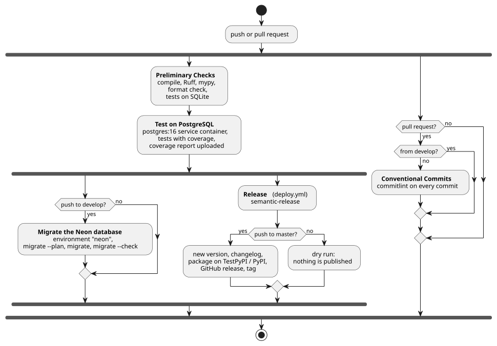

# CI/CD

## What is automated, and why

Every check we would otherwise have to remember to run by hand is run by GitHub Actions. That covers the static checks and tests, the commit messages, the schema of the shared database, the releases and the dependency updates:

| What | When | Repository | Why |
|---|---|---|---|
| Syntax, lint, type and format checks; test suite | every push and pull request | backend, frontend | a broken change is caught while it is still on its own branch |
| Test suite on PostgreSQL, with coverage | every push and pull request | backend | full-text search and the concurrency rules only exist on PostgreSQL (see [Validation](../05-validation/index.md)) |
| Build and tests on 3 operating systems × 3 Node versions | every push and pull request | frontend | the frontend is built and run on machines we do not control |
| Commit message check (commitlint) | every pull request | backend | semantic-release reads the version bump from the messages, and a malformed one is a release that silently does not happen |
| Migrations applied to the shared Neon database | every push to `develop`, once the tests pass | backend | the database the team works against always has the schema of `develop`, and nobody has to remember to run `migrate` |
| Release: version, changelog, tag, GitHub release, package | every push to the stable branch, once the tests pass | backend, frontend | the version number follows from the commits, with no manual step to forget or get wrong |
| Dependency update pull requests | every Monday (Dependabot), as soon as a new version is out (Renovate) | backend, frontend | updates arrive small and tested, one dependency at a time |
| Merge of patch and minor dependency updates | once the required checks pass | backend, frontend | routine updates do not wait for a person; major ones do |

A few things are deliberately left to a person: publishing to the real PyPI instead of TestPyPI (a repository variable switches it, see below), merging a major dependency update, and merging a pull request written by one of us, which the other reads first.

The pipelines are written as YAML workflows in `.github/workflows/` of each repository. The jobs depend on one another through `needs`, so a later job starts only if the earlier ones passed; the release lives in its own workflow (`deploy.yml`), which the main one calls as a [reusable workflow](https://docs.github.com/en/actions/using-workflows/reusing-workflows) (`workflow_call`) and which can also be started by hand from the Actions tab (`workflow_dispatch`).

## Backend pipeline

The backend has four workflows. The main one, `check.yml`, runs four jobs:

1. **Preliminary Checks** installs the project with Poetry and runs, through Poe the Poet tasks, `compileall` (syntax), Ruff and mypy (`static-checks`), `ruff format --check` (formatting), and the test suite on the default in-memory SQLite. The last step makes sure the suite keeps passing with no database server, as it does on a developer's machine.
2. **Test on PostgreSQL** runs only if the first job passed. It starts a `postgres:16` [service container](https://docs.github.com/en/actions/using-containerized-services/about-service-containers), the same image as the `db` service of `docker-compose.yml`, waits for its health check, and sets `TEST_DATABASE_URL` so that the suite runs on it and the tests marked `postgres` are no longer skipped. Pytest is called with `-rs`, which lists any skipped test in the log: none should be skipped here. Coverage is measured on this run, because it is the only one that reaches the FAQ matching, and its HTML report is uploaded as a build artifact named after the commit.
3. **Migrate the Neon database** runs only on a push to `develop` (i.e. a merged pull request), and only once both test jobs are green, so a work branch or a red build never touches the database the team shares. It prints the migration plan first, so the log records what was applied, then runs `migrate` and finally `migrate --check`, which fails if anything is left unapplied. A `concurrency` group without cancellation makes two merges in a row migrate one after the other, and never stops a migration halfway.
4. **Deploy** calls `deploy.yml`, described below.

The workflow ignores pushes that only change files with no effect on the code (`README.md`, `LICENSE`, `CHANGELOG.md`, `.gitignore`, `.github/dependabot.yml`). It also ignores pushes to `dependabot/**` branches: Dependabot always opens a pull request, which runs the same jobs, so the push would only run them twice.

**Reproducible environment.** The jobs run on Python 3.12, the version of the backend's Docker image. The Poetry version is written only once, in the `Dockerfile` (`ARG POETRY_VERSION=2.2.1`), and every job reads it from there with `sed`, so CI and the image can never drift apart; the dependencies come from `poetry.lock`. The migration job installs only the runtime dependencies (`poetry install --only main`), which is all `migrate` needs.

**Commit messages.** `commitlint.yml` runs on every pull request and checks each of its commits against `@commitlint/config-conventional`, with the limit on body line length turned off, since bodies quote URLs and logs. It is skipped on the release pull request from `develop`: its commits were already checked when they reached `develop`, and it also carries commits from before the check existed, which can no longer be reworded.

**Release.** `deploy.yml` runs semantic-release, configured in `release.config.mjs` on top of the `semantic-release-preconfigured-conventional-commits` preset. The job decides first whether this is a real release or a dry run: it is a dry run on any branch other than `master`, and on the very first commit of the repository, which has no parent to compare with. In a real release semantic-release:

1. computes the next version from the commits since the last tag (`fix`, `perf`, `docs` and `revert` → patch, `feat` → minor, a breaking change `type!` → major; `chore`, `ci`, `test` and `refactor` alone produce no release) and writes the changelog;
2. records the version in `pyproject.toml` (`poetry version`);
3. builds the package and uploads it (`poetry publish --build`), to TestPyPI or to PyPI;
4. creates the tag and the GitHub release, with the built files in `dist/` attached;
5. commits `CHANGELOG.md` and `pyproject.toml` back to `master` with the message `chore(release): <version> [skip ci]`, which starts no new pipeline.

In a dry run it computes the version and prints the notes, but publishes nothing. Every branch has its own `concurrency` group, so releases on `master` run strictly one at a time, while the dry runs of different branches do not cancel one another. Versions `1.0.0` and `1.0.1` of the backend were released this way. How versions are chosen and what the artefacts contain is described in [Release](../06-release/index.md).

**Dependency updates.** Dependabot (`.github/dependabot.yml`) checks every Monday morning the Python dependencies, the npm dependencies of semantic-release, the GitHub Actions used by the workflows, and the Docker images of the `Dockerfile` and of `docker-compose.yml`. It opens its pull requests against `develop`, with Conventional Commit messages (`chore(deps)`, `ci(deps)`) that do not produce a release by themselves. For the Docker images only patch updates are proposed: a new Python, Node or PostgreSQL version is changed by hand, together with the workflows. `dependabot-automerge.yml` reads the kind of update and, for a patch or minor one, turns on GitHub's auto-merge, so the pull request is merged as soon as the required checks of `develop` pass; a major update waits for one of us. Auto-merge relies on those required checks: without them, GitHub would merge the update at once, untested.

**Branch protection.** `develop` requires the checks *Preliminary Checks*, *Test on PostgreSQL* and *Conventional Commits* to pass before a pull request can be merged.

## Frontend pipeline

The frontend's `check.yml` runs three jobs:

1. **check** installs the dependencies with `npm ci` (exactly those of `package-lock.json`), runs ESLint and oxlint, the type check (`vue-tsc --build`), and the whole Vitest suite with coverage. The run fails if coverage drops below the thresholds in `vitest.config.ts` (95% of lines, statements and functions, 90% of branches); the coverage report is uploaded as a build artifact.
2. **test** runs on a matrix of 3 operating systems (Ubuntu, Windows, macOS) and 3 Node versions (20, 22, 24): 9 jobs, each building the production bundle with Vite and running the test suite. Dates and times are formatted in the `Europe/Rome` time zone on every machine (`vitest.config.ts` sets it before the tests start), so the same test gives the same result on all of them.
3. **deploy** runs only on a push to `main`, once every job of the matrix has passed, and calls the frontend's `deploy.yml`. semantic-release computes the version in the same way as in the backend, records it in `package.json` (the npm plugin runs with `npmPublish: false`, since the frontend is not published as a package), creates the tag and the GitHub release, and commits `CHANGELOG.md` and `package.json` back with `[skip ci]`. Version `1.0.0` of the frontend was released this way.

Renovate (`renovate.json`) keeps the frontend's dependencies up to date. It opens a separate pull request for each major, minor and patch update, uses semantic commit messages (with type `ci` for updates of the workflows), and merges them automatically once the checks pass. Pushes to `renovate/**` branches are ignored by `check.yml`, for the same reason as Dependabot's in the backend.

## Secrets, variables and permissions

No credential is written in a workflow. The workflows read them from GitHub's encrypted secrets, which never appear in a log (GitHub masks them), and pass them to the commands as environment variables:

| Name | Kind | Repository | Used by | Purpose |
|---|---|---|---|---|
| `DB_NAME`, `DB_USER`, `DB_PASSWORD`, `DB_HOST`, `DB_PORT` | secrets of the `neon` environment | backend | Migrate the Neon database | connection to the shared database; `DB_SSLMODE` is set to `require` in the workflow, since Neon only accepts encrypted connections |
| `PYPI_TOKEN` | repository secret | backend | Release | API token of the package index, passed to Poetry as `POETRY_PYPI_TOKEN_PYPI` and `POETRY_PYPI_TOKEN_TESTPYPI`, so it never appears in a command |
| `PUBLISH_TO_PYPI` | repository variable | backend | Release | the release goes to the real PyPI only when it is `true`; if the variable is missing or has any other value, it goes to TestPyPI, so a mistake can never publish to PyPI |
| `GITHUB_TOKEN` | generated by GitHub for each run | backend | Release, auto-merge | pushes the release commit and the tag, creates the GitHub release, turns on auto-merge; it expires with the run, so there is no personal token to renew |
| `RELEASE_TOKEN` | repository secret | frontend | Release | token semantic-release uses to push the release commit and create the GitHub release |
| `TEST_DATABASE_URL` | plain variable in the workflow | backend | Test on PostgreSQL | points the suite to the service container; its credentials exist only inside the CI runner |
| `SECRET_KEY` | plain variable, generated per run | backend | Migrate the Neon database | Django refuses to start without one, but `migrate` signs nothing, so a throwaway value (`migrate-only-<run id>`) is used instead of another secret |
| `RELEASE_DRY_RUN`, `RELEASE_TEST_PYPI` | computed in the workflow | backend, frontend | Release | read by `release.config.mjs` to choose between a dry run and a real release, and between TestPyPI and PyPI |

The database credentials belong to a GitHub [environment](https://docs.github.com/en/actions/deployment/targeting-different-environments/using-environments-for-deployment) (`neon`) rather than to the repository, so only the job that declares `environment: neon` can read them. Required reviewers can be added to that environment in the repository settings, without changing the workflow, if a migration should ever wait for approval.

Each workflow asks only for the permissions of the `GITHUB_TOKEN` it needs: `commitlint.yml` can only read the repository and its pull requests, the auto-merge job can write to pull requests, and only the release job can push commits, create releases, and comment on the issues and pull requests a release ships.

## Limits

- On the frontend, the `lint` script runs ESLint and oxlint with `--fix`. In CI this fixes what it can on the runner's copy and fails only on the problems that cannot be fixed automatically, so a fixable problem passes CI and stays in the repository. Prettier formatting is not checked in CI at all.
- The frontend repository has no commitlint workflow and no branch protection, so the Conventional Commits rule there depends on review.
- Nothing is deployed to a server automatically. The pipeline stops at the release: running a release on a server is described in [Deployment](../07-deployment/index.md).
