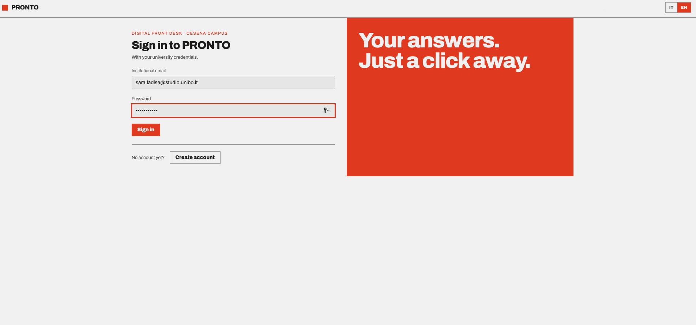
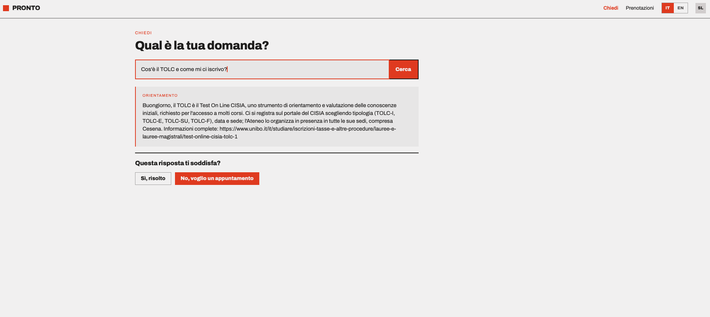
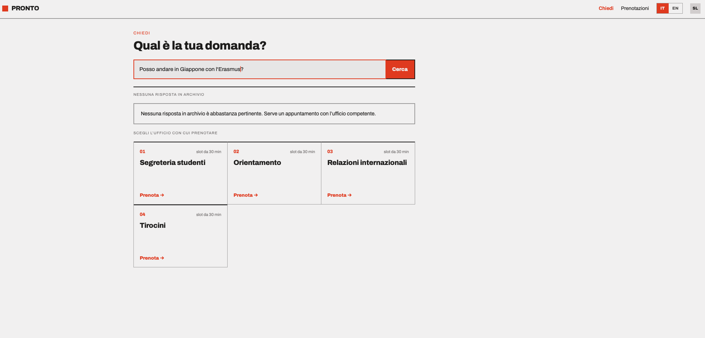
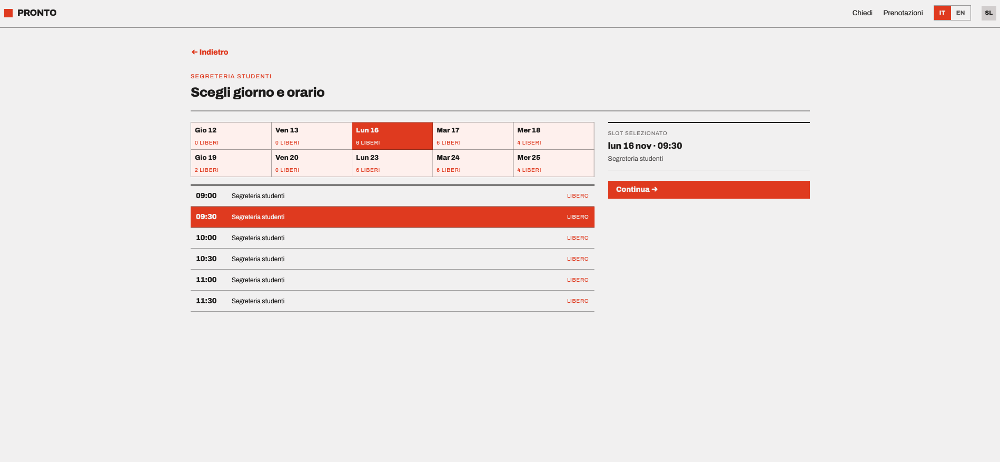
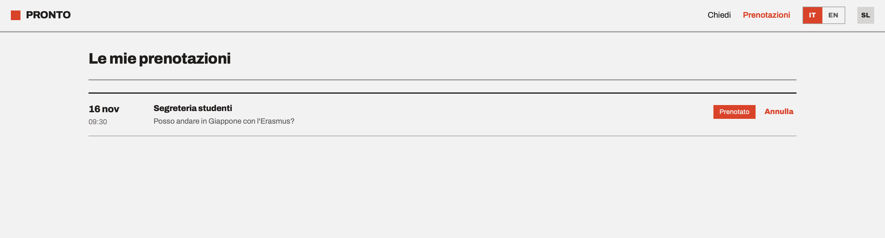
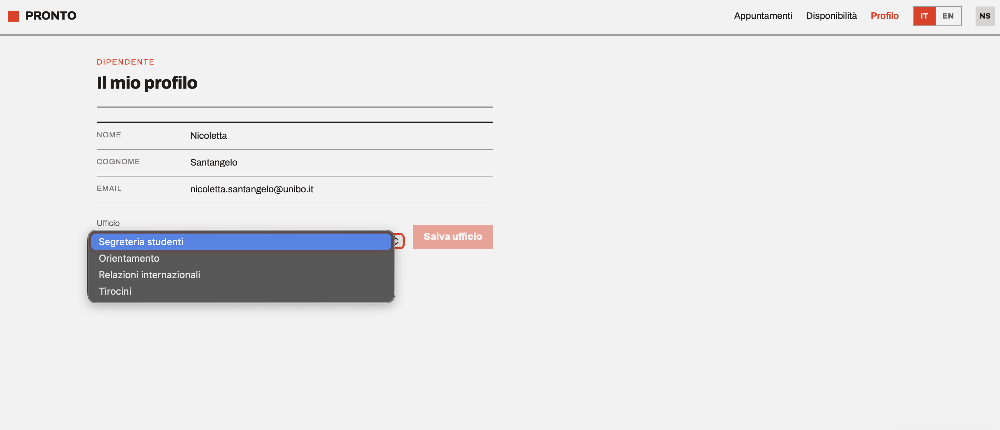
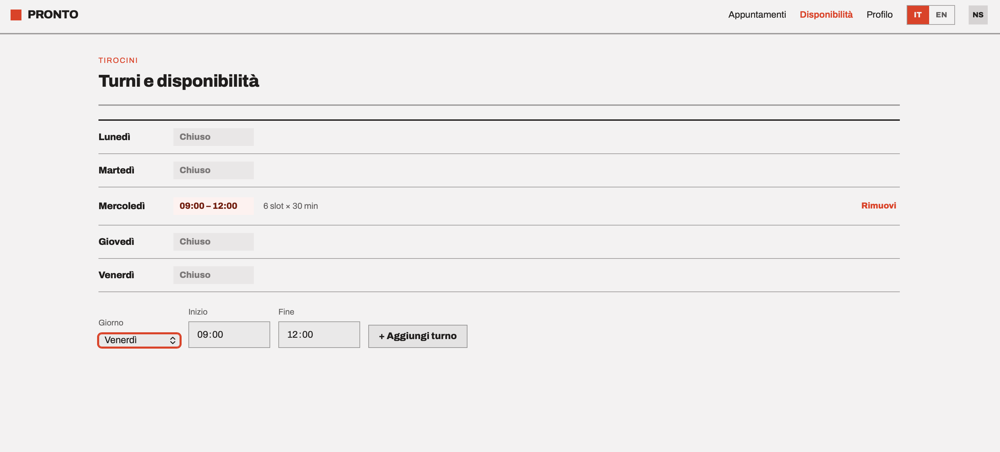
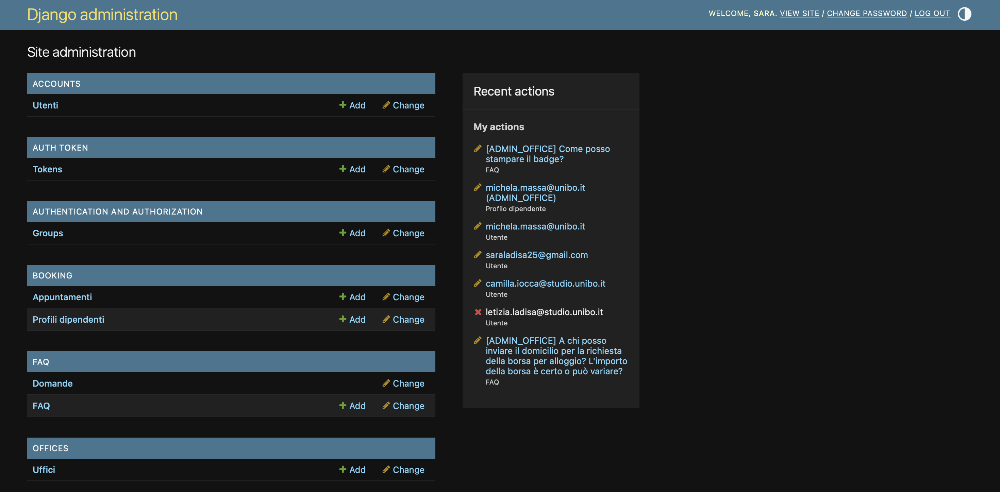
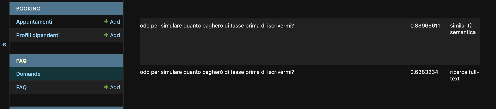

# User Guide

This section explains how to use PRONTO once it has been installed as described in [Deployment](../07-deployment/). It covers the three roles: students, who ask questions and book appointments; staff, who declare their shifts and handle the appointments; and the administrator, who manages offices, FAQs and users.

## Starting and stopping PRONTO

From the folder that contains `docker-compose.release.yml`, start the stack with:

    docker compose -f docker-compose.release.yml up -d

then open <http://localhost:8080> in the browser. The data is kept between restarts. The stack does not start again by itself after the computer or Docker restarts, so the same command is needed each time. To stop it:

    docker compose -f docker-compose.release.yml down

The interface is available in Italian and English: the **IT** / **EN** switch in the header changes the language at any time.

## Signing in and registering

Everyone signs in with their institutional e-mail address and password. A new user chooses **No account yet?** and fills in the registration form.

The e-mail address decides the role: an `@studio.unibo.it` address creates a student account, which also asks for the student ID and the degree programme, while an `@unibo.it` address creates a staff account. Once the account is created, the user can sign in right away. In production, sign-in would go through the university identity provider; the project uses this form to keep things simple.

After signing in, students land on **Ask** and staff on **Appointments**. The menu under the user's name in the header contains **Sign out**.

## Students

### Asking a question
On **Ask**, the student types the question in their own words and chooses **Search**. There is no need to know which office handles it: PRONTO compares the question with the FAQs of all offices.

When an archived answer is relevant enough, PRONTO shows it together with the office it belongs to, and asks **Does this answer satisfy you?**

- **Yes, solved** closes the question without an appointment. The question stays in the archive and helps improve future answers. **Ask another question** starts again.
- **No, I want an appointment** starts a booking with the office of that answer.

When no archived answer is relevant enough, the question needs an appointment. The student chooses the office from the list, which also shows the length of each office's slots, and selects **Book**.

### Booking an appointment

**Pick a day and a time** shows the next ten working days with the number of free slots on each. The student selects a day, then a time, and chooses **Continue**.

**Review and confirm** summarises the office, the date and time, and the question, which can still be edited. If PRONTO had suggested an FAQ, it appears here as well, and the officer will also see it. **Confirm booking** registers the appointment, assigns it to a member of staff of that office and sends a confirmation e-mail.

### Managing bookings

**Bookings** lists the student's appointments with their status: *Booked*, *Cancelled* or *Completed*. An appointment that has not taken place yet can be cancelled with **Cancel**; after the confirmation, the slot becomes free again for other students.

## Staff

### Choosing the office

A new staff member first opens **Profile**, chooses the office they work for and selects **Save office**. Until then, the availability page only asks them to choose an office.

### Declaring the shifts

**Availability** shows the weekly shifts, one row per day, with *Closed* on the days without shifts. To add one, the staff member picks the day, the start and the end time and chooses **Add shift**; **Remove** deletes it. PRONTO divides each shift into slots of the office's length, and only these slots are offered to students.

### Handling the appointments

**Appointments** lists the appointments assigned to the staff member, with the date and time, the student, the question and the status. When the student had already been shown an FAQ, it is marked next to the question, so the officer knows what the student has read. **Upcoming** shows only the booked appointments, **All** also the cancelled and completed ones. Once the time of an appointment has come, **Complete** marks it as done.

## Administrator

The administrator account is created during the installation. When the administrator signs in, PRONTO opens the administration site at <http://localhost:8080/admin/>, where the administrator manages the offices and the length of their slots, the FAQs used to answer the questions, and the users.

### Details on how the FAQs were found

Under **Domande**, the administration site lists the questions students have asked. For each question it shows the office, the suggested FAQ, its score, whether the student marked it as resolved, and in **trovata con** the method that found the FAQ: *ricerca full-text*, when the words of the question matched an FAQ, or *similarità semantica*, when full-text search found nothing and PRONTO looked for an FAQ with a vector similarity search.

